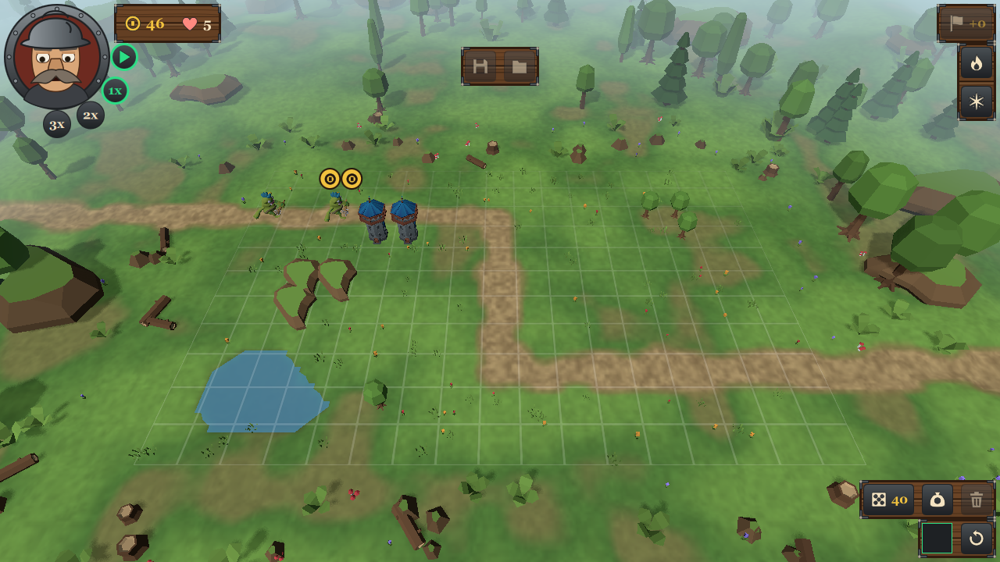

# QtowerDefense

A fantasy tower defense game in 3D, built with Qt 6.12, Qt Quick 3D and CMake.



Enemies march along fixed paths, and you stop them with towers on the free fields of the grid. Towers
come as cards: roll the dice for new ones, keep up to five in your hand, and drag one onto the map.
A hero comments on the battle and holds two spells, Meteor and Deep Freeze.

## Features

- **Campaign** on a world map in the fog: nine sections, each with its own landscape, stars for
  each map, and new sections that open as you win.
- **Endless mode:** the waves keep coming and grow stronger, with a best score for each section.
- **7 tower types** with two upgrades each, selling for a partial refund, and a target priority for
  each tower (first, last, strongest, nearest).
- **8 enemy types and 2 bosses** with damage types, resistances, slowing and poison.
- **Flow:** call a wave early for bonus gold, play at 1x/2x/3x speed or pause, and save a running
  game and resume it later.
- **Controls** by mouse or touch, with three control sizes (small, normal, large) and three
  levels of picture quality (low, medium, high).
- **Languages:** English and German.

## Play

- **In the browser:** [deivadder.github.io/QtowerDefense](https://deivadder.github.io/QtowerDefense/)
  (a large download of about 53 MB, the first start takes a while).
- **Download:** the [latest release](https://github.com/DeiVadder/QtowerDefense/releases/latest)
  has a package for Windows, macOS and Linux. Unpack it and start `QtowerDefense`; Qt comes along.
  - **Windows:** `bin\QtowerDefense.exe`. Windows SmartScreen may warn, the program is not signed.
    If Windows reports a missing `VCRUNTIME140.dll` or `MSVCP140.dll`, run `bin\vc_redist.x64.exe`
    once; it installs the Microsoft Visual C++ runtime.
  - **macOS:** `QtowerDefense.app`, for Apple Silicon and Intel with macOS 14.4 or newer (the oldest Qt 6.12 runs on). The app is
    not notarized: open it the first time with right-click and *Open*, or run
    `xattr -dr com.apple.quarantine QtowerDefense.app`.
  - **Linux:** `bin/QtowerDefense`, built on Ubuntu 24.04 for x86-64. It needs the usual desktop
    libraries (OpenGL, xcb or Wayland, fontconfig), which every desktop system has.

## Platforms

| Platform | State |
|---|---|
| Windows | Built and tested on every change; release package built by GitHub Actions |
| macOS | Built and played on Apple Silicon; release package built by GitHub Actions |
| Linux | Release package built by GitHub Actions |
| Browser (WebAssembly) | Built and played locally; GitHub Actions publishes it on GitHub Pages |
| iOS, Android | Prepared in CMake (presets, icons, bundle settings), never built |

The browser build saves progress and settings in the visitor's own browser (IndexedDB). It plays
its sounds through Web Audio, because Qt 6.12 has no Qt Multimedia for WebAssembly; the sounds were
checked to decode and start, but nobody has listened to them yet. The download is large (about
53 MB), so the first start takes a while. It links Qt statically: the source of the game is this
repository, the source of Qt 6.12.0 (which also covers the FFmpeg libraries that Qt Multimedia
brings into the desktop packages) is at [download.qt.io](https://download.qt.io/archive/qt/6.12/6.12.0/single/).

## Building

You need, on Windows:

- Qt 6.12 for MSVC 2022 with the modules Qt Quick 3D, Qt Shader Tools and Qt Multimedia, and the
  Qt Linguist tools;
- MSVC 2022 (x64);
- CMake 3.30 or newer and Ninja on the `PATH`.

Open an "x64 Native Tools Command Prompt for VS 2022", point `QTD_QT_DIR` at the Qt kit, and
build with the presets:

```
set QTD_QT_DIR=C:\Qt\6.12.0\msvc2022_64
set PATH=%QTD_QT_DIR%\bin;%PATH%
cmake --preset release
cmake --build --preset release
build\release\bin\QtowerDefense.exe
```

The game finds the Qt DLLs through the `PATH`. To run the tests, build the `debug` preset and run
`ctest --preset debug`. On the development machine, `scripts/env.cmd` sets all of this up; it uses
the machine's own paths.

Presets for development and analysis (`debug`, `asan`, `ubsan`, `coverage`) and for the other
platforms (`macos`, `linux`, `ios`, `android`, `wasm`) are described in
[docs/Building.md](docs/Building.md) (German).

## Design

- **Deterministic simulation:** a fixed tick, fixed-point numbers, its own random number
  generator, and a single thread. The same seed and the same commands always give the same game,
  so replays and golden tests check the rules exactly.
- **Layers:** `qtd_core` (the simulation, Qt Core only) → `qtd_automation` (bots, replays, control
  interface) → `qtd_client` (Qt Quick 3D and QML) → the game, plus `qtd_headless` for runs without a
  window.
- **Data-driven content:** maps, towers, enemies, spells and the world map are JSON files in
  [content](content).
- **One set of commands** for players and bots: the game can also be played through JSON lines on
  standard input ([docs/Steuerschnittstelle.md](docs/Steuerschnittstelle.md), German).

The process documentation in [docs](docs) is in German. It covers the architecture, decisions,
balancing and progress.

## License

Copyright (C) 2026 The QtowerDefense authors

QtowerDefense is free software: you can redistribute it and modify it under the terms of the GNU
General Public License, version 3 or (at your option) any later version (GPL-3.0-or-later). See
[LICENSE](LICENSE).

All models, textures and sounds come from CC0 packs by Kenney, Kay Lousberg (KayKit) and
Quaternius. The icon is the project's own, drawn by `scripts/make_icon.py`, and shares the
project's license. Each file is listed with its source in [docs/ASSETS.md](docs/ASSETS.md).
